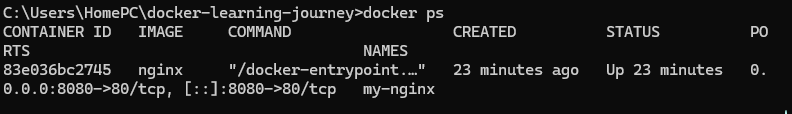
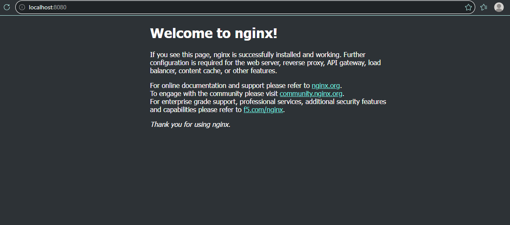

\# Lab 01: Running Your First Docker Container


\## 1. Objective


The objective of this lab is to understand how to download a Docker image, run a container, expose a port, and verify that an application is working.


\## 2. Prerequisites


\* Docker Desktop installed and running.

\* Windows Command Prompt.

\* Basic knowledge of Docker commands.


\## 3. Tools Used


\* Docker Desktop

\* Nginx

\* Windows Command Prompt

\* Web browser


\## 4. Practical Implementation


\### Step 1: Verify Docker


```cmd

docker --version

docker info

```


Confirm that Docker is installed and the Docker Engine is running.


\### Step 2: Download the Nginx Image


```cmd

docker pull nginx

```


This downloads the Nginx image from Docker Hub.


\### Step 3: Run the Container


```cmd

docker run -d --name my-nginx -p 8080:80 nginx

```


Explanation:


\* `docker run` creates and starts a container.

\* `-d` runs it in the background.

\* `--name my-nginx` assigns a name to the container.

\* `-p 8080:80` maps port 8080 on the host to port 80 in the container.

\* `nginx` specifies the image.


\### Step 4: Verify the Container


```cmd

docker ps

```


Confirm that the `my-nginx` container is running.


\### Step 5: Test the Application


Open the following address in a web browser:


http://localhost:8080


The expected result is the Nginx welcome page.


\## 5. Results and Evidence


Record the results of the following checks:


\* Docker image downloaded successfully.

\* Nginx container started successfully.

\* Container appeared in `docker ps`.

\* Nginx welcome page loaded in the browser.

The Nginx image downloaded successfully. The container appeared in docker ps, and the welcome page loaded at http://localhost:8080.


Add screenshots of the successful results.

## Evidence

### Running Container



### Nginx Welcome Page




\## 6. Challenges Encountered


No issues encountered.


\## 7. Troubleshooting and Solutions


No issues encountered.


\## 8. Key Lessons


I learned how Docker uses images to create containers and how port mapping makes an application accessible from the host.


\## 9. Cleanup


Stop the container:


```cmd

docker stop my-nginx

```


Remove the container:


```cmd

docker rm my-nginx

```


The Nginx image remains available locally unless it is removed separately.

